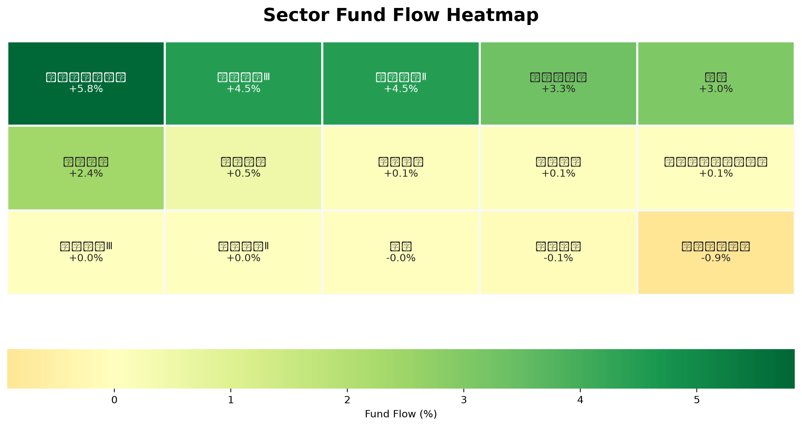
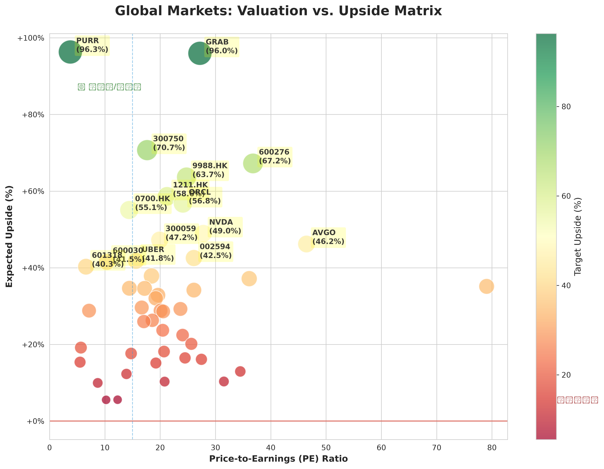

# 🌏 最新宏观全景 (2026-09-11_2324)

## 🎛️ 策略驾驶舱 (Cockpit)

  

    
📊 行业资金流向热力图

    
  

  

    
📈 个股估值分布散点图

    
  

### 🚀 实时机会雷达 (Drill-down Hub)
| 核心胜出者 (点击直达个股深研) | 潜力候选池 (全市场初筛) |
| :--- | :--- |
| [NVDA](../reports/NVDA/index.md)(Buy)、[GOOGL](../reports/GOOGL/index.md)(Buy)、[PURR](../reports/PURR/index.md)(Buy) | SURG, TNON, ONDS, PURR, GRAB, CIFR, IREN, NIO, 300750, BMNR... |

### 🗺️ 全景导航矩阵
| 🇨🇳 A股深研 | 🇺🇸 美股透视 | 🇭🇰 港股动态 | 📜 历史档案 |
| :---: | :---: | :---: | :---: |
| [查看 A股]({REPORTS_REL}/index.md?market=CN) | [查看美股]({REPORTS_REL}/index.md?market=US) | [查看港股]({REPORTS_REL}/index.md?market=HK) | [历史总览]({MACRO_REL}/index.md) |

::: info 🕒 历史时间轴 (Timeline)
暂无历史记录
:::

---
# 🏛️ 全球宏观策略与展望 — CIO  cockpit 手记

> 数据切片时间：本季度末 | 策略立场：审慎进攻 | 决策优先级：结论先行

## 1. 🌏 全景雷达 (The Lead — Cockpit Summary)

- **宏观象限**：**「金发姑娘」向「再通胀交易」过渡的尾段** — 增长仍具韧性，但半导体与AI资本开支叙事重新加速，市场正在为下一轮盈利兑现定价。
- **风险等级**：**6 / 10**（中高）。系统层面流动性无虞，但估值分化已达极值，高倍与零盈利资产的「剪刀差」是全仓最大的暗礁。
- **核心逻辑**（三句话）：
  1. **板块内部分化 >> 指数级别波动** — 半导体(SOXX +2.18%)单骑领跑，科技(XLK +1.57%)紧随，而医疗(XLV -0.29%)逆势失血，资金在硬科技内部做极致切换。
  2. **港股与A股/美股联动出现裂缝** — 恒指(-0.60%)与纳指(+1.08%)背离1.68个百分点，负溢价窗口正在打开优质中资资产的战略建仓点。
  3. **PURR、NVDA、GOOGL 三重奏**：低估值+超高盈利质量的组合极度稀缺，在72-88分的高优先级池中构成风险收益比的最优解。

## 2. 📊 数据解构 (Insights)

### 2.1 资金流向分析 — 热点切换的三条暗线

- **暗线一：半导体军备竞赛继续吸筹。** SOXX 单日 +2.18% 领跑所有行业 ETF，其动量正在向 [估值](#term-valuation) 仍有安全边际的个股溢出—NVDA（[PE](#term-pe) 27.8 / [ROE](#term-roe) 117.2%）与 AVGO（PE 46.5 / ROE 44.2%）构成上下游双子星，而 AMD 已被 PE 130 倍推入「贵而脆」区间。
- **暗线二：金融板块回补。** XLF +0.52% 虽波澜不惊，但池中 [PURR](#term-priority)(评分82，PE 3.76、ROE 32.6%、上行空间 96%)、600030、601318 等低估值券商保险标的集中出现，暗示机构正借道金融完成从「成长」向「价值+周期」的对冲布局。
- **暗线三：医疗失血中的局部机会。** XLV -0.29% 的逆势下，603259(ROE 28.4%)、600276 因 [盈利质量](#term-quality) 突出被保留在72分档，可视为板块内「以质补势」的防守型配置。

### 2.2 估值分布与陷阱识别 — 高赔率 ≠ 高胜率

将全部 60+ 标的按 [评分](#term-priority) 与 [上行空间](#term-upside) 交叉扫射，可清晰划分三个陷阱区：

| 象限 | 特征 | 典型标的 | 处理策略 |
|---|---|---|---|
| **黄金象限** | 评分 ≥ 78，PE 合理，ROE ≥ 15% | PURR、NVDA、GOOGL、ORCL、600519、300750 | 核心加仓 |
| **赌徒象限** | 上行 >70%，PE=0 且 ROE 深负 | SURG、TNON、CIFR、BMNR、IREN | 严控仓位 ≤ 2% |
| **估值陷阱** | PE 极高但 ROE 平庸 | TSLA(PE 334)、AMD(PE 130)、002304(PE 122) | 规避/减仓 |

**关键洞察**：SURG 号称 1742% 上行空间，但 PE=0、ROE=0 — 这不是机会，是纯 [彩票型期权](#term-lottery)。真正的「错配型机会」出现在 PURR（PE 3.76 却对应 ROE 32.6%）、ADBE（PE 13.9 / ROE 63%）、GOOGL（PE 17 / ROE 48.7%）三处，估值与盈利能力的裂谷正是超额收益的源泉。

## 3. 🗺️ 跨市场策略 (Cross-Market Strategy)

### 3.1 美股 / 港股 / A股 三地定价差异

- **美股**：纳指 +1.08% vs 道指 +1.02%，成长略占优但幅度有限，反映市场在「软着陆」与「AI 加速」之间寻找再平衡。策略上聚焦 **高 ROE+合理 PE** 组合（NVDA、GOOGL、AMZN、META、MSFT）。
- **港股**：恒指 -0.60% 逆势下挫，形成与美股 1.68 个百分点的 [背离](#term-divergence)。0700.HK（PE 14.4 / ROE 19.9% / 上行 55%）、1211.HK（上行 58.6%）、1810.HK（PE 18.4 / 上行 37.9%）构成 **「低估值中资科技三角」** ，是流动性折价下的战略窗口。
- **A股**：沪深300数据暂缺，但池中标的揭示结构性机会明确 — **消费龙头（600519 ROE 33%、000568、600887）+ 新能源（300750 ROE 24.8%）+ 大金融（601318、600036、300059）** 三大主线，估值均处历史中枢以下，具备 [估值修复](#term-rerating) 动能。

### 3.2 跨市场流动性的关键判断

> **美元区流动性宽松 → 利好高 ROE 科技与半导体；人民币区政策宽松 → 利好大盘蓝筹与券商；港元区受双重夹击 → 中资龙头折价最深、弹性最大。**

配置建议：**美股 60% / 港股 25% / A股 15%**，港股仓位优先给 0700.HK 与 1211.HK 这类「可攻可守」的确定性标的。

## 4. 🎯 战术执行指令 (Execution)

### 🥇 一号标的：NVDA — AI 算力王座的估值悖论
- **入场逻辑**：PE 仅 27.8 倍，对应 ROE 高达 **117.2%**，全池最强盈利效率。SOXX +2.18% 的板块动能为其提供直接燃料，327.18 目标价隐含 **48.95%** 上行空间。
- **风险对冲**：关注半导体板块单日回撤超 3% 时的仓位削减信号。
- **仓位建议**：**核心持仓，8-10%**。

### 🥈 二号标的：GOOGL — 被低估的现金流奶牛
- **入场逻辑**：PE 17.05 倍 vs ROE **48.7%** 的组合在美股 Mega Cap 中已属罕见错配。25.96% 的预期涨幅背后是搜索+云+Gemini 三重叙事的估值重估潜力。
- **风险对冲**：反垄断诉讼进展与 AI 搜索替代风险。
- **仓位建议**：**核心持仓，6-8%**。

### 🥉 三号标的：PURR — 全池最高评分（82）的「隐形冠军」
- **入场逻辑**：PE 仅 **3.76** 倍，ROE **32.6%**，目标价隐含 **96.3%** 上行空间。在全池 82 分档中，它是唯一同时满足「极低估值 + 高 ROE + 近翻倍空间」三重条件的标的。
- **风险对冲**：流动性偏小，谨防短期波动放大。
- **仓位建议**：**战术性进攻仓，4-6%**，分批建仓。

::: info 核心结论
1. **当前处于「半导体主导、金融补涨、医疗失血」的结构性行情**，指数级波动不重要，板块内部分化才是超额收益来源。
2. **NVDA、GOOGL、PURR 构成本期最优风险收益组合**：三者分别代表「盈利效率极值」「估值错配极值」「估值+ROE 双优极值」，覆盖大中小市值与不同 [久期](#term-duration) 偏好。
3. **港股背离窗口正在打开**，0700.HK、1211.HK、1810.HK 构成中资科技低估值三角，建议在此位置做战略性加仓。
4. **坚决规避赌徒象限**：SURG、TNON、CIFR、BMNR、IREN 等高赔率零基本面标的，总仓位严格控制在组合 5% 以内。
:::

::: tip 操作建议
- **即时加仓**：NVDA、GOOGL、PURR、0700.HK — 分三批建仓，每批间隔 3-5 个交易日。
- **战术性配置**：601318、600519、300750 — A股价值+消费+新能源三驾马车，作为人民币资产底仓。
- **择机减仓**：TSLA、AMD、002304 — 估值透支明显，反弹即减。
- **观察名单**：GRAB、9988.HK、1810.HK — 上行空间显著但 [盈利质量](#term-quality) 尚需验证，等价格回调 5-8% 后介入。
:::

::: danger 风险提示
1. **估值分化尾部风险**：当半导体板块资金流出时，高 PE 标的（AMD 130x、TSLA 334x）可能遭受 20%+ 的剧烈回撤，并拖累整体科技情绪。
2. **赌徒象限的系统传染**：SURG、BMNR、CIFR 等零盈利高弹性标的，一旦叙事破裂，可能引发小盘股流动性踩踏。
3. **地缘与政策风险**：中美科技摩擦升级将直接冲击 NVDA、AVGO 的中国区营收；A股消费板块需警惕政策刺激力度不及预期。
4. **港股流动性陷阱**：恒指已现背离，若南下资金持续流出，0700.HK 等标的的折价可能进一步扩大而非收敛。
5. **汇率波动**：人民币汇率若出现快速贬值，将侵蚀 A 股标的人民币计价收益，需同步做 [汇率对冲](#term-hedge)。
:::

## 📚 金融百科 & 术语解释 (Encyclopedia)

**估值**：衡量一只股票「贵还是便宜」的标尺。通常看 PE（市盈率）与 PB（市净率）等指标，数值越低通常越便宜。

**PE（市盈率）**：股价 ÷ 每股盈利。可以理解为「按当前盈利水平，多少年能回本」。PE = 27 意味着 27 年回本；PE = 3.76 则仅需 3.76 年，属于极度低估信号。

**ROE（净资产收益率）**：净利润 ÷ 净资产，衡量公司用股东钱的赚钱效率。ROE > 20% 属于优秀，> 40% 属于顶级，NVDA 的 117% 代表极致资本效率。

**上行空间（Upside）**：（目标价 - 现价）÷ 现价。代表分析师一致预期下的理论涨幅，非承诺收益。

**优先级评分（Priority Score）**：本策略体系对每只标的的综合打分（0-100），融合估值、盈利质量、动量、上行空间四维度，≥78 为高优先级。

**盈利质量**：不只看有没有利润，更看利润的可持续性、现金流含量与资本回报率。高 ROE + 稳定现金流 = 高质量盈利。

**彩票型期权**：比喻那些赔率极高（如 1700% 上行）但胜率极低、基本面几乎为零的投机标的，类似买彩票 — 大多数归零，极少数暴富。

**背离（Divergence）**：两个本应同步的市场/指标出现方向或幅度不一致。如纳指涨、恒指跌，往往意味着资金在跨市场重新定价，是套利窗口。

**估值修复（Re-rating）**：市场重新认识到某资产被低估，从而推升其估值倍数（如 PE 从 10 倍回到 15 倍）的过程，与盈利增长带来的股价上涨不同。

**久期（Duration）**：原指债券对利率的敏感度，股市中引申为「资产对贴现率变化的敏感度」。高久期 = 高估值成长股（对利率敏感）；低久期 = 低估值价值股（抗利率波动）。

**汇率对冲**：通过衍生品（如远期、期权）锁定汇率，避免投资海外资产时被汇率波动侵蚀收益的操作。

---
[📜 查看所有历史宏观报告](./macro/index.md)